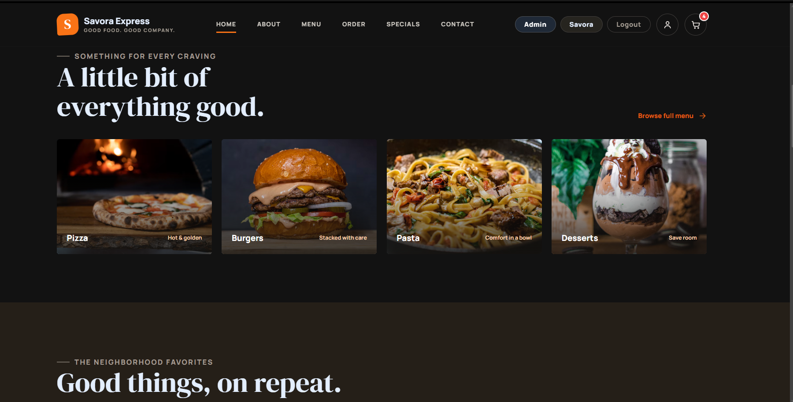
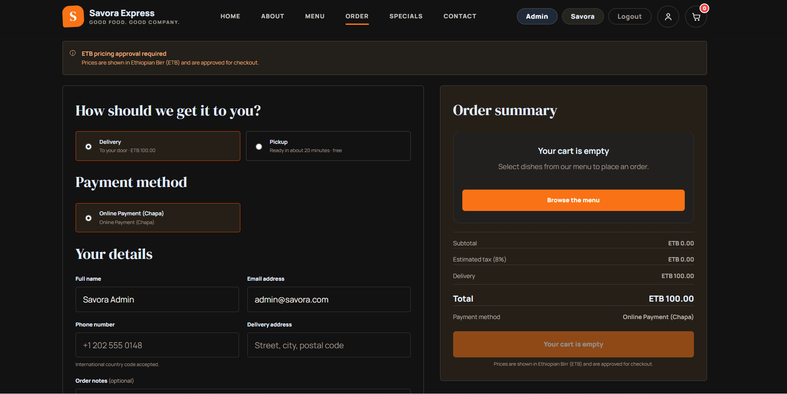
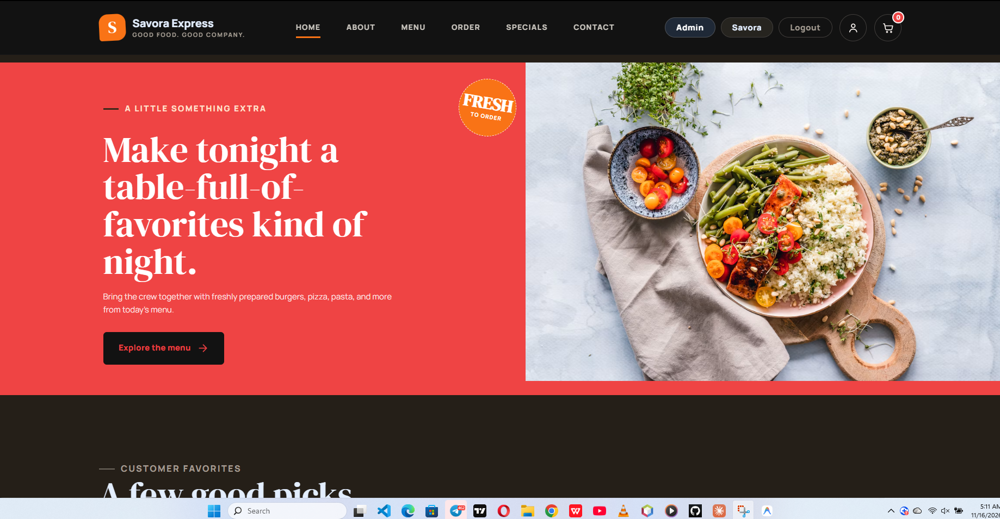

# Savora Express — Full-Stack Restaurant Ordering & Admin Platform

[](https://savora-express.vercel.app)
[](https://nodejs.org)
[](https://expressjs.com)
[](https://www.prisma.io)
[](https://neon.tech)
[](https://chapa.co)
[](https://nodejs.org/api/test.html)

**Savora Express** is a production-grade, full-stack restaurant ordering and management web application. Built with high performance and accessibility in mind, the platform delivers a fast, responsive customer ordering experience with **Ethiopian Birr (ETB)** pricing, online payments via **Chapa**, non-blocking **Telegram & Email order alerts**, and a dedicated **Admin Operations Console**.

---

## 🌐 Live Production URLs

| Resource | Direct Link | Description |
| :--- | :--- | :--- |
| **Live Application** | [savora-express.vercel.app](https://savora-express.vercel.app) | Production storefront deployed on Vercel Serverless |
| **Interactive Menu** | [savora-express.vercel.app/menu.html](https://savora-express.vercel.app/menu.html) | Searchable and filterable dish catalog with ETB pricing |
| **Checkout & Chapa Payment** | [savora-express.vercel.app/checkout.html](https://savora-express.vercel.app/checkout.html) | Delivery/pickup selection and Chapa ETB checkout |
| **About & Story** | [savora-express.vercel.app/about.html](https://savora-express.vercel.app/about.html) | Restaurant story, kitchen values, and brand heritage |
| **Admin Operations Console** | [savora-express.vercel.app/admin.html](https://savora-express.vercel.app/admin.html) | Protected administrative management and order fulfillment |
| **GitHub Repository** | [github.com/gshumie/Savora-express](https://github.com/gshumie/Savora-express) | Complete source code, migrations, tests, and documentation |

---

## 📸 Screenshots & UI Walkthrough

### 1. Hero & Brand Experience
*Full-bleed culinary hero section featuring signature dishes, brand motto (**"Delicious Moments, Delivered Fresh."**), responsive dark navigation bar with real-time session authentication state (`Admin` / `User` / `Logout`), and clear call-to-action buttons.*

<p align="center">
  
</p>

---

### 2. Interactive Menu & Category Showcase
*Dynamic category showcase (**"A little bit of everything good."**) featuring high-resolution food photography, curated offerings across **Pizza**, **Burgers**, **Pasta**, and **Desserts**, and fast navigation to the filtered catalog.*

<p align="center">
  
</p>

---

### 3. Seamless Checkout & Chapa ETB Payments
*Streamlined multi-step checkout: fulfillment switcher between **Doorstep Delivery** (ETB 100.00 flat) and **Store Pickup** (Free, ready in ~20 minutes), accurate minor-unit ETB calculations (subtotal, 8% VAT, delivery fee, grand total), authenticated customer profile prefill, and official Ethiopian Birr online payments via **Chapa**.*

<p align="center">
  
</p>

---

### 4. Featured Specials & Promotions
*High-impact promotional banner (**"Make tonight a table-full-of-favorites kind of night."**) highlighting freshly prepared recipes, fresh-to-order kitchen badges, and direct catalog discovery shortcuts.*

<p align="center">
  
</p>

---

### 5. Restaurant Story & Kitchen Heritage
*Editorial brand narrative (**"Food that brings us closer."** and **"Made with care. Meant to be shared."**) presenting the kitchen's origins, culinary philosophy, and neighborhood dedication.*

<p align="center">
  
</p>

---

## 🌟 Key Features

### 🍽️ Customer Experience & Ordering
- **Interactive Menu Catalog**: Browse seeded restaurant dishes categorized into Burgers, Pizza, Pasta, Chicken, Drinks, and Desserts with live category filtering, search, and popularity sorting.
- **Persistent Shopping Cart**: Unified client-server cart architecture that saves items locally in browser storage and synchronizes with server-side shopping carts for both guests and authenticated users.
- **Flexible Fulfillment Modes**: Select between **Doorstep Delivery** (ETB 100.00 flat fee with required delivery address) or **Store Pickup** (Free, ready in ~20 minutes).
- **Accurate Monetary Precision**: Monetary totals (subtotal, 8% VAT, delivery fee, grand total) are calculated using integer minor-unit arithmetic to eliminate floating-point rounding errors.
- **User Authentication & Profiles**: Complete user authentication lifecycle (registration, login, profile view, session revocation logout) powered by secure JWTs and bcrypt password hashing.

### 💳 Secure ETB Payments (Chapa)
- **Ethiopian Birr Gateway**: Native integration with the official **Chapa API** supporting both test and live environments.
- **Hosted Payment Redirect**: Customers are securely redirected to Chapa's official checkout page (`checkout.chapa.co`) to pay via local debit cards or mobile wallets (Telebirr, CBE Birr, etc.).
- **Tamper-Proof Verification**: Authenticated webhook handlers with HMAC-SHA256 signature verification and cryptographic order-status tokens to guarantee payment status integrity.
- **Safe Fallbacks**: In local development without live gateway credentials, the system automatically falls back to an interactive simulated test payment flow.

### 🔔 Real-Time Order Notifications
- **Telegram Bot Alerts**: Instant, rich HTML notifications sent to staff Telegram channels when an order is created or payment is confirmed. Includes customer name, phone, delivery address, order notes, and an itemized dish breakdown.
- **Staff Email Notifications**: Automated order alert emails dispatched via SMTP (e.g., Gmail) or the Resend REST API.
- **Non-Blocking Architecture**: Notifications run asynchronously via `Promise.allSettled` wrapped in defensive error handling, ensuring external network hiccups never delay or block checkout or webhook execution.

### 🛡️ Admin Operations Console (`/admin.html`)
- **Role-Based Access Control**: Restricted strictly to users with the `ADMIN` role.
- **Executive Metrics**: At-a-glance KPI summary tracking total lifetime orders, confirmed ETB revenue, registered customer accounts, and active catalog items.
- **Live Order Management**: View all incoming orders in chronological order with one-click status transitions (`PENDING` ➔ `CONFIRMED` ➔ `PREPARING` ➔ `OUT_FOR_DELIVERY` ➔ `DELIVERED` ➔ `CANCELLED`).
- **Expandable Order Dossier**: Click `Details ▾` on any order to inspect full customer contact information, delivery instructions, payment transaction references, and an itemized line-item receipt.
- **Menu Stock & Catalog Controls**: Toggle dish availability (Active/Inactive), view inventory stock numbers, and add new dishes directly to the menu.

---

## 🛠️ Tech Stack & Architecture

| Layer | Technology | Purpose |
| :--- | :--- | :--- |
| **Frontend** | Vanilla HTML5, CSS3, ES6+ JS | Lightweight, zero-framework, lightning-fast client loading with CSS variables and responsive design |
| **Backend** | Node.js (>=20), Express.js | Modular RESTful API architecture using native ES modules (`type: "module"`) |
| **Database** | PostgreSQL on Neon | Serverless PostgreSQL with connection pooling and SSL encryption |
| **ORM** | Prisma ORM 6 | Type-safe database queries, schema modeling, automated migrations, and database seeding |
| **Security** | Helmet, CORS, Rate-Limiting | HTTP security headers, CORS origin whitelisting, client IP subnet normalization, and bcrypt salt hashing |
| **Payments** | Chapa API | ETB checkout initialization, transaction verification, and webhook signature validation |
| **Notifications** | Telegram Bot API, Nodemailer | Non-blocking multi-channel alerts on order lifecycle events |
| **Deployment** | Vercel Serverless | Hosted with `@vercel/node` serverless runtime with asset bundling |

---

## 📂 Repository Structure

```text
savora-express/
├── index.html                  # Landing page, hero, category highlights, specials, and reviews
├── menu.html                   # Full searchable and filterable menu catalog
├── checkout.html               # Multi-step checkout, cart summary, delivery options, and payment
├── login.html                  # User authentication (Login, Register, and Account Profile)
├── admin.html                  # Protected administrative dashboard and order fulfillment console
├── about.html                  # Restaurant story, values, history, and kitchen details
├── contact.html                # Contact form, opening hours, and location information
├── style.css                   # Unified design system, CSS variables, dark header, and responsive layout
├── script.js                   # Client-side router, state hydration, cart engine, and UI handlers
├── server.js                   # Express application entry point, static asset serving, and serverless export
├── vercel.json                 # Vercel serverless build and routing configuration
├── package.json                # Dependencies, engines, and automated npm scripts
├── prisma/
│   ├── schema.prisma           # Relational database models (User, Order, OrderItem, Payment, etc.)
│   ├── seed.js                 # Database seed script for default catalog dishes and admin user
│   └── migrations/             # Timestamped SQL migration history
├── src/
│   ├── config.js               # Centralized configuration with production safety guards and URL validation
│   ├── db/prisma.js            # Prisma client instance with Neon serverless connection adapter
│   ├── lib/                    # Core utility libraries (money arithmetic, JWT auth, cart identity, etc.)
│   ├── middleware/             # Express middlewares (auth guards, pricing approval, rate limiting)
│   ├── routes/                 # Express API route modules (auth, products, cart, orders, admin)
│   └── services/               # External service integrations (Chapa, notifications, Stripe, payment status)
├── tests/                      # Automated unit and integration test suite (131 tests)
└── docs/
    └── screenshots/            # Application walkthrough screenshots and demo assets
```

---

## 🚀 Local Setup & Installation

### Prerequisites
- **Node.js**: `v20.0.0` or higher installed
- **PostgreSQL**: Local PostgreSQL instance OR a free cloud database on [Neon.tech](https://neon.tech)

### 1. Clone the Repository
```bash
git clone https://github.com/gshumie/Savora-express.git
cd "Savora express"
```

### 2. Install Dependencies
```bash
npm install
```

### 3. Configure Environment Variables
Copy the template configuration file:
```bash
cp .env.example .env
```
Open `.env` and fill in your database URLs and private secrets (see the [Environment Variables](#-environment-variables-reference) table below).

### 4. Run Database Migrations
Deploy the committed Prisma schema migrations to your PostgreSQL database:
```bash
npx prisma migrate deploy
```

### 5. Seed Initial Catalog & Admin User (Optional)
Populate the database with the 12 approved catalog dishes and the default administrator account:
```bash
# On Windows PowerShell:
$env:ALLOW_DATABASE_SEEDING="true"; npm run prisma:seed

# On macOS/Linux:
ALLOW_DATABASE_SEEDING="true" npm run prisma:seed
```
> Default Admin Credentials: `admin@savora.com` / `Admin@Savora2026!`

### 6. Start the Application
Run the local development server with auto-reload:
```bash
npm run dev
```
Open [http://localhost:3000](http://localhost:3000) in your web browser.

---

## ⚙️ Environment Variables Reference

| Variable | Required | Default / Format | Description |
| :--- | :---: | :--- | :--- |
| `NODE_ENV` | Optional | `development` | Runtime environment (`development`, `production`, `test`) |
| `PORT` | Optional | `3000` | Local HTTP server port |
| `DATABASE_URL` | **Yes** | `postgresql://...` | Connection pooled PostgreSQL URL used at runtime |
| `DIRECT_URL` | **Yes** | `postgresql://...` | Direct non-pooled PostgreSQL URL used for Prisma CLI migrations |
| `JWT_SECRET` | **Yes** | 32+ character hex string | Secret key for signing user authentication JWT tokens |
| `PAYMENT_STATUS_TOKEN_SECRET` | **Yes** | 32+ character string | Secret used to sign guest order status lookup tokens |
| `PAYMENT_PROVIDER` | **Yes** | `chapa` | Active payment gateway (`chapa`, `stripe`, or `demo`) |
| `CHAPA_SECRET_KEY` | Optional | `CHASECK_TEST-...` | Secret API key obtained from your Chapa merchant dashboard |
| `CHAPA_WEBHOOK_SECRET` | Optional | `your-secret-hash` | Secret hash used to verify Chapa webhook signatures |
| `CHAPA_ENVIRONMENT` | Optional | `test` or `live` | Chapa execution mode |
| `CHAPA_CURRENCY` | Optional | `ETB` | Catalog currency code (must be `ETB`) |
| `ETB_PRICES_APPROVED` | **Yes** | `true` | Must be `true` to enable checkout |
| `CLIENT_URL` | **Yes** | `https://savora-express.vercel.app` | Base URL used for browser redirects and CORS origin checks |
| `APP_BASE_URL` | **Yes** | `https://savora-express.vercel.app` | Base URL used to construct payment return and webhook callbacks |
| `TELEGRAM_BOT_TOKEN` | Optional | `123456:ABC-DEF...` | Telegram Bot token for real-time order alerts |
| `TELEGRAM_CHAT_ID` | Optional | `-100...` or `12345...` | Target Telegram group or chat ID receiving order alerts |
| `ADMIN_NOTIFY_EMAIL` | Optional | `orders@savoraexpress.com` | Destination inbox for order notification emails |
| `SMTP_HOST` | Optional | `smtp.gmail.com` | Outgoing SMTP mail server |
| `SMTP_PORT` | Optional | `587` | SMTP port (`587` for STARTTLS, `465` for SSL) |
| `SMTP_USER` | Optional | `username@gmail.com` | SMTP authentication username |
| `SMTP_PASS` | Optional | `app-password` | SMTP authentication app password |
| `ALLOW_DATABASE_SEEDING` | Optional | `false` | Explicit opt-in flag required to seed non-production databases |

---

## 📡 Core REST API Endpoints

### 🔐 Authentication (`/api/auth`)
- `POST /api/auth/register` — Register a new customer account
- `POST /api/auth/login` — Authenticate user and receive JWT session cookie
- `GET /api/auth/me` — Retrieve the currently authenticated user's profile
- `POST /api/auth/logout` — Revoke session token and clear authentication cookie

### 🍕 Menu & Catalog (`/api/products`)
- `GET /api/products` — Retrieve active menu items with approved ETB prices
- `GET /api/products/categories` — List all dish categories
- `POST /api/products` — Create a new dish *(Admin only)*
- `PATCH /api/products/:id` — Update dish details or toggle active status *(Admin only)*

### 🛒 Shopping Cart (`/api/cart`)
- `GET /api/cart` — Fetch items in the current guest session or user cart
- `POST /api/cart/items` — Add a dish or increment quantity (max 99 per item)
- `PUT /api/cart/items/:id` — Update line item quantity
- `DELETE /api/cart/items/:id` — Remove an item from the cart
- `DELETE /api/cart` — Clear all items from the cart

### 📦 Orders & Payments (`/api/orders`)
- `GET /api/checkout-config` — Public configuration (currency, price approval, payment provider)
- `POST /api/orders/checkout` — Submit order and initialize payment session
- `POST /api/orders/chapa/webhook` — Verified Chapa payment callback endpoint
- `POST /api/orders/payment-status` — Polling status check using cryptographic order token
- `GET /api/orders` — List past orders for the authenticated customer
- `GET /api/orders/:id` — Inspect order details and receipt

### 📊 Admin Operations (`/api/admin`)
- `GET /api/admin/summary` — Aggregate revenue, order count, and customer metrics
- `GET /api/admin/orders` — Complete list of orders with line items and customer information
- `PATCH /api/admin/orders/:id/status` — Transition order fulfillment status

---

## 🧪 Automated Testing

The project includes a comprehensive automated test suite built on Node.js's native test runner (`node:test` and `node:assert/strict`).

Run the full test suite:
```bash
npm test
```

### Test Suite Coverage (131 Passing Tests)
- **Financial Calculations**: Minor-unit conversion, 8% VAT rounding, and delivery fee rules.
- **Pricing Guards**: Price approval enforcement preventing unauthorized price alterations.
- **Cart Consistency**: Slug migration, session deduplication, and quantity boundary caps.
- **Security & Authentication**: Active session verification, cookie extraction, rate-limiter IP subnet bucketing, and privilege separation.
- **Chapa Gateway**: Transaction payload serialization, webhook signature verification, and environment auto-detection.
- **Notifications**: Message formatting, Telegram HTML escaping, and non-blocking failure tolerance.

---

## ☁️ Production Deployment (Vercel)

The repository is pre-configured for zero-friction serverless deployment on **Vercel**:

1. **Push to GitHub**: Connect your GitHub repository to your Vercel project.
2. **Set Environment Variables**: In your Vercel Project Settings ➔ **Environment Variables**, configure all production variables from the [reference table](#-environment-variables-reference).
3. **Build Settings**:
   - **Framework Preset**: Other
   - **Build Command**: `prisma generate` (automatically handled by `"postinstall": "prisma generate"`)
   - **Output Directory**: `.` (Root)
4. **Deploy**:
   ```bash
   npx vercel --prod
   ```

---

## 📄 License
This project is licensed under the [MIT License](LICENSE).
